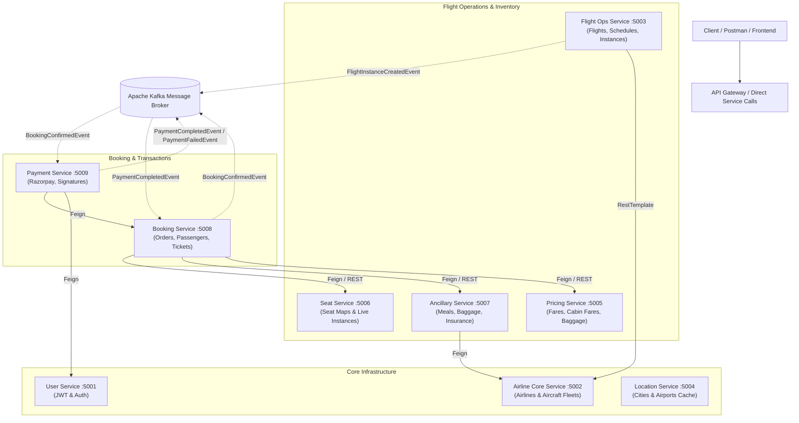
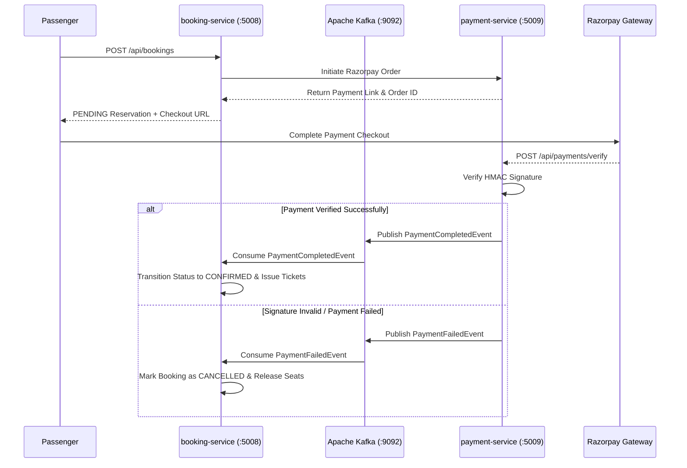

# ✈️ Airline Management System — Enterprise Microservices Architecture

A production-grade, distributed **Airline Management & Operations Platform** built with **Java 17**, **Spring Boot 3.x / 4.x**, **Spring Cloud OpenFeign**, **Apache Kafka**, **Razorpay Gateway**, **Spring Security**, and **PostgreSQL**.

---

## 📑 Table of Contents
1. [Architecture & Topology](#-architecture--topology)
2. [Tech Stack](#-tech-stack)
3. [Repository & Module Structure](#-repository--module-structure)
4. [Services Deep-Dive & API Directory](#-services-deep-dive--api-directory)
   - [1. User & Authentication Service (`user-service`)](#1-user--authentication-service-user-service--port-5001)
   - [2. Airline Core Service (`airline-core-service`)](#2-airline-core-service-airline-core-service--port-5002)
   - [3. Flight Operations Service (`flight-ops-service`)](#3-flight-operations-service-flight-ops-service--port-5003)
   - [4. Location & Navigation Service (`location-service`)](#4-location--navigation-service-location-service--port-5004)
   - [5. Pricing & Fares Service (`pricing-service`)](#5-pricing--fares-service-pricing-service--port-5005)
   - [6. Seat Management Service (`Seat-Service`)](#6-seat-management-service-seat-service--port-5006)
   - [7. Ancillary & Meals Service (`ancillary-service`)](#7-ancillary--meals-service-ancillary-service--port-5007)
   - [8. Booking & Passenger Service (`booking-service`)](#8-booking--passenger-service-booking-service--port-5008)
   - [9. Payment & Gateway Service (`payment-service`)](#9-payment--gateway-service-payment-service--port-5009)
   - [10. Shared Common Library (`common-lib`)](#10-shared-common-library-common-lib)
5. [Event-Driven Messaging (Apache Kafka)](#-event-driven-messaging-apache-kafka)
6. [Inter-Service Communication Map](#-inter-service-communication-map)
7. [Database Setup & Management](#-database-setup--management)
8. [Configuration & Environment Variables](#-configuration--environment-variables)
9. [Setup, Build & Execution Guide](#-setup-build--execution-guide)
10. [Testing with Postman](#-testing-with-postman)
11. [Security Architecture](#-security-architecture)

---

## 🏗 Architecture & Topology

The platform operates as a decentralized microservices ecosystem where each domain is isolated with its own PostgreSQL database, interacting via synchronous REST (OpenFeign & RestTemplate) and asynchronous messaging (Apache Kafka):



---

## 🚀 Tech Stack

| Domain | Technology / Library |
| :--- | :--- |
| **Language** | Java 17 (LTS) |
| **Framework** | Spring Boot 3.x / 4.x, Spring Framework 6.x |
| **Security & Auth** | Spring Security, JJWT (io.jsonwebtoken 0.12.6) with HMAC-SHA256 |
| **Persistence** | Spring Data JPA, Hibernate ORM, PostgreSQL JDBC Driver |
| **Database** | PostgreSQL (9 isolated database schemas) |
| **Messaging & Events** | Apache Kafka (spring-kafka) with JSON Serialization |
| **Inter-Service** | Spring Cloud OpenFeign, Spring `RestTemplate` |
| **Payment Gateway** | Razorpay Java SDK (`razorpay-java:1.4.3`) |
| **Caching** | Spring Cache Abstraction (`ConcurrentMapCacheManager`) |
| **Validation** | Jakarta Bean Validation (`hibernate-validator`) |
| **Productivity** | Project Lombok |
| **Build & Packaging** | Apache Maven (Multi-Module Reactor Architecture) |

---

## 📁 Repository & Module Structure

```
airline-system/
├── pom.xml                                           # Root Reactor Parent POM
└── microservice/
    ├── pom.xml                                       # Services Parent Aggregator
    ├── common-lib/                                   # Shared Artifact (JAR) for all services
    │   └── src/main/java/com/noir/
    │       ├── domain/                               # Ancillary & Baggage Metadata
    │       ├── embeddable/                           # Address, GeoCode, Benefits, Support
    │       ├── enums/                                # Statuses, Roles, Types
    │       ├── event/                                # Kafka Event Records
    │       └── payload/                              # Requests & Responses DTOs
    ├── cloud/                                        # Cloud Configurations & Registry
    └── services/                                     # 9 Discrete Microservice Applications
        ├── user-service/             Port 5001       # Authentication & Customer Profiles
        ├── airline-core-service/     Port 5002       # Airline Profiles, Fleet & Governance
        ├── flight-ops-service/       Port 5003       # Flights, Recurring Schedules & Instances
        ├── location-service/         Port 5004       # Cities, Airports & Caching
        ├── pricing-service/          Port 5005       # Fares, Baggage Policies & Fare Rules
        ├── Seat-Service/             Port 5006       # Cabin Classes, Seat Maps & Layouts
        ├── ancillary-service/        Port 5007       # Ancillaries, In-flight Meals, Insurance
        ├── booking-service/          Port 5008       # Passenger Records, Bookings & Tickets
        └── payment-service/          Port 5009       # Razorpay Orders, Verify & Event Listeners
```

---

## 📦 Services Deep-Dive & API Directory

---

### 1. User & Authentication Service (`user-service`) — Port `5001`
* **Database:** `airline_user_db`
* **Responsibilities:**
  - User registration, password encryption via BCrypt, and secure login.
  - Generates HMAC-SHA256 signed JWT tokens containing `email`, `userId`, and `authorities`.
  - Customer profile retrieval and management.

#### Endpoints
| HTTP Method | Route | Description | Headers / Params |
| :--- | :--- | :--- | :--- |
| `POST` | `/auth/signup` | Register a new user | Body: `UserDTO` / Register Request |
| `POST` | `/auth/login` | Authenticate credentials & return JWT | Body: `LoginRequest` |
| `GET` | `/api/users/profile` | Get currently logged-in user profile | Header: `X-User-Email: <email>` |
| `GET` | `/api/users/{userId}` | Get user details by user ID | Path: `userId` |
| `GET` | `/api/users` | List all registered users (Admin) | None |

#### Sample Request (`POST /auth/signup`):
```json
{
  "fullName": "John Doe",
  "email": "john.doe@example.com",
  "password": "Password@123",
  "role": "ROLE_USER"
}
```

---

### 2. Airline Core Service (`airline-core-service`) — Port `5002`
* **Database:** `airline_db`
* **Responsibilities:**
  - Manages airline master data (IATA/ICAO code, alliance, logo, customer care info).
  - Aircraft fleet inventory: physical configurations, registration numbers, seat capacity by cabin class.
  - Airline governance: approval, suspension, and banning by system administrators.

#### Endpoints — Airlines
| HTTP Method | Route | Description | Headers / Params |
| :--- | :--- | :--- | :--- |
| `POST` | `/api/airlines` | Create new airline record | Header: `X-User-Id: <ownerId>`, Body: `AirlineRequest` |
| `GET` | `/api/airlines/admin` | Get airline owned by the caller | Header: `X-User-Id: <ownerId>` |
| `GET` | `/api/airlines/{id}` | Get airline profile by ID | Path: `id` |
| `GET` | `/api/airlines` | Paginated listing of all airlines | Query: `page`, `size`, `sort` |
| `GET` | `/api/airlines/dropdown` | Lightweight list of active airlines | None |
| `PUT` | `/api/airlines` | Update airline information | Header: `X-User-Id`, Body: `AirlineRequest` |
| `DELETE` | `/api/airlines/{id}` | Delete airline record | Header: `X-User-Id`, Path: `id` |
| `POST` | `/api/airlines/{id}/approve` | Admin approves airline (`ACTIVE`) | Path: `id` |
| `POST` | `/api/airlines/{id}/suspend` | Admin suspends airline (`INACTIVE`)| Path: `id` |
| `POST` | `/api/airlines/{id}/ban` | Admin bans airline (`BANNED`) | Path: `id` |

#### Endpoints — Aircraft Fleet
| HTTP Method | Route | Description | Headers / Params |
| :--- | :--- | :--- | :--- |
| `POST` | `/api/aircrafts` | Register aircraft to airline fleet | Header: `X-User-Id`, Body: `AircraftRequest` |
| `GET` | `/api/aircrafts/{id}` | Get aircraft specs by ID | Path: `id` |
| `GET` | `/api/aircrafts` | List all aircraft for current owner | Header: `X-User-Id` |
| `PUT` | `/api/aircrafts/{id}` | Update aircraft specifications | Header: `X-User-Id`, Path: `id` |
| `DELETE` | `/api/aircrafts/{id}` | Remove aircraft from fleet | Header: `X-User-Id`, Path: `id` |

#### Sample Request (`POST /api/airlines`):
```json
{
  "iataCode": "AI",
  "icaoCode": "AIC",
  "name": "Air India",
  "alias": "Air India Ltd",
  "logoUrl": "https://example.com/logo.png",
  "website": "https://www.airindia.in",
  "alliance": "Star Alliance",
  "headquartersCityId": 1,
  "supportEmail": "support@airindia.in",
  "supportPhone": "+9118001801407",
  "supportHours": "24/7"
}
```

---

### 3. Flight Operations Service (`flight-ops-service`) — Port `5003`
* **Database:** `airline_flight_db`
* **Responsibilities:**
  - Flight master creation and origin/destination route configuration.
  - Recurring flight schedules (days of week, departure/arrival times, seasonal dates).
  - Specific flight instances generation for specific dates.
  - Publishes `FlightInstanceCreatedEvent` over Apache Kafka upon instance initialization.

#### Endpoints — Flights (`/api/flights`)
| HTTP Method | Route | Description | Headers / Params |
| :--- | :--- | :--- | :--- |
| `POST` | `/api/flights` | Create new flight master | Header: `X-User-Id`, Body: `FlightRequest` |
| `GET` | `/api/flights/{id}` | Get flight by ID | Path: `id` |
| `GET` | `/api/flights/airline` | Paginated flights by airline | Header: `X-User-Id`, Query: airports, pageable |
| `PUT` | `/api/flights/{id}` | Update flight master details | Path: `id`, Body: `FlightRequest` |
| `PATCH` | `/api/flights/{id}/status` | Update status (SCHEDULED, CANCELLED)| Path: `id`, Query: `status` |
| `DELETE` | `/api/flights/{id}` | Delete flight | Header: `X-User-Id`, Path: `id` |

#### Endpoints — Flight Schedules (`/api/flight-schedules`)
| HTTP Method | Route | Description | Headers / Params |
| :--- | :--- | :--- | :--- |
| `POST` | `/api/flight-schedules` | Create recurring schedule | Body: `FlightScheduleRequest` |
| `GET` | `/api/flight-schedules/{id}` | Get schedule by ID | Path: `id` |
| `GET` | `/api/flight-schedules` | List all schedules | None |
| `PUT` | `/api/flight-schedules/{id}` | Update schedule | Path: `id`, Body: `FlightScheduleRequest` |
| `DELETE` | `/api/flight-schedules/{id}` | Delete schedule | Path: `id` |

#### Endpoints — Flight Instances (`/api/flight-instances`)
| HTTP Method | Route | Description | Headers / Params |
| :--- | :--- | :--- | :--- |
| `POST` | `/api/flight-instances` | Generate flight instance for date | Header: `X-User-Id`, Body: `FlightInstanceRequest` |
| `GET` | `/api/flight-instances/{id}` | Get instance details | Path: `id` |
| `GET` | `/api/flight-instances` | Search instances by route/date | Header: `X-User-Id`, Query: airports, date, pageable |
| `PUT` | `/api/flight-instances/{id}` | Update instance timings/status | Path: `id`, Body: `FlightInstanceRequest` |
| `DELETE` | `/api/flight-instances/{id}` | Delete flight instance | Path: `id` |

---

### 4. Location & Navigation Service (`location-service`) — Port `5004`
* **Database:** `airline_location_db`
* **Responsibilities:**
  - Master repository of global cities (country, timezone offset, coordinates).
  - Master repository of international airports (3-letter IATA code, terminal address, coordinates).
  - High-performance Spring Cache (`ConcurrentMapCacheManager`) for instant airport lookup with auto cache eviction.

#### Endpoints — Cities (`/api/cities`)
| HTTP Method | Route | Description |
| :--- | :--- | :--- |
| `POST` | `/api/cities` | Create city (Body: `CityRequest`) |
| `GET` | `/api/cities/{id}` | Fetch city by ID |
| `GET` | `/api/cities` | List all cities (paginated) |
| `PUT` | `/api/cities/{id}` | Update city details |
| `DELETE` | `/api/cities/{id}` | Remove city |
| `GET` | `/api/cities/search` | Search cities by keyword |
| `GET` | `/api/cities/country/{countryCode}` | Get cities by 2-letter country code |
| `GET` | `/api/cities/exists/{cityCode}` | Check if city code exists |

#### Endpoints — Airports (`/api/airports`)
| HTTP Method | Route | Description |
| :--- | :--- | :--- |
| `POST` | `/api/airports` | Register airport (Body: `AirportRequest`) |
| `GET` | `/api/airports/{id}` | Get airport by ID *(Cached)* |
| `GET` | `/api/airports` | Get all airports *(Cached)* |
| `PUT` | `/api/airports/{id}` | Update airport *(Evicts cache)* |
| `DELETE` | `/api/airports/{id}` | Delete airport *(Evicts cache)* |
| `GET` | `/api/airports/city/{cityId}` | Get all airports in city *(Cached)* |
| `GET` | `/api/airports/iata/{iataCode}` | Lookup airport by 3-letter IATA code |

---

### 5. Pricing & Fares Service (`pricing-service`) — Port `5005`
* **Database:** `airline_pricing_db`
* **Responsibilities:**
  - Manages base fares, taxes, airline surcharges, and cabin class pricing.
  - Baggage allowance policies: weight, piece concept, dimensions, priority bags.
  - Dynamic fare rules (cancellation, refundability, change fees).
  - Batch lowest fare calculation for flight search results.

#### Endpoints — Fares (`/api/fares`)
| HTTP Method | Route | Description |
| :--- | :--- | :--- |
| `POST` | `/api/fares` | Create fare structure (Body: `FareRequest`) |
| `GET` | `/api/fares` | List all fares |
| `GET` | `/api/fares/{id}` | Get fare details by ID |
| `GET` | `/api/fares/flight/{flightId}/cabin-class/{cabinClassId}` | Fares for specific flight & cabin class |
| `POST` | `/api/fares/batch-by-ids` | Bulk get fares by list of IDs |
| `GET` | `/api/fares/lowest/flight/{flightId}/cabin-class/{cabinClassId}` | Lowest fare for flight cabin |
| `POST` | `/api/fares/search` | Batch lowest fare across list of flights |
| `PUT` | `/api/fares/{id}` | Update fare pricing |
| `DELETE` | `/api/fares/{id}` | Delete fare record |

#### Endpoints — Baggage Policies (`/api/baggage-policies`)
| HTTP Method | Route | Description |
| :--- | :--- | :--- |
| `POST` | `/api/baggage-policies` | Create baggage policy (Body: `BaggagePolicyRequest`) |
| `GET` | `/api/baggage-policies/{id}` | Get baggage policy by ID |
| `GET` | `/api/baggage-policies/fare/{fareId}` | Get policy mapped to fare ID |
| `GET` | `/api/baggage-policies/airline/{airlineId}` | List policies by airline |
| `PUT` | `/api/baggage-policies/{id}` | Update baggage policy |
| `DELETE` | `/api/baggage-policies/{id}` | Delete baggage policy |

#### Endpoints — Fare Rules (`/api/fare-rules`)
| HTTP Method | Route | Description |
| :--- | :--- | :--- |
| `POST` | `/api/fare-rules` | Create fare rule policy |
| `GET` | `/api/fare-rules/{id}` | Get fare rule by ID |
| `GET` | `/api/fare-rules/fare/{fareId}` | Get rules mapped to fare ID |
| `GET` | `/api/fare-rules/airline/{airlineId}` | List fare rules by airline |
| `PUT` | `/api/fare-rules/{id}` | Update fare rule |
| `DELETE` | `/api/fare-rules/{id}` | Delete fare rule |

---

### 6. Seat Management Service (`Seat-Service`) — Port `5006`
* **Database:** `airline_seat_db`
* **Responsibilities:**
  - Aircraft cabin layout configuration: Economy, Premium Economy, Business, First Class.
  - Seat maps (rows, columns, left seats, right seats, aisles).
  - Seat instances for flights: window/aisle, legroom, power outlets, real-time availability.
  - Seat pricing calculation engine.

#### Endpoints — Cabin Classes (`/api/cabin-classes`)
| HTTP Method | Route | Description |
| :--- | :--- | :--- |
| `POST` | `/api/cabin-classes` | Create cabin class (Body: `CabinClassRequest`) |
| `GET` | `/api/cabin-classes/{id}` | Get cabin class by ID |
| `GET` | `/api/cabin-classes/aircraft/{id}/name/{name}` | Find cabin class on aircraft |
| `GET` | `/api/cabin-classes/aircraft/{aircraftId}` | List all cabin classes for aircraft |
| `PUT` | `/api/cabin-classes/{id}` | Update cabin class |
| `DELETE` | `/api/cabin-classes/{id}` | Delete cabin class |

#### Endpoints — Seat Maps & Seats (`/api/seat-maps` & `/api/seats`)
| HTTP Method | Route | Description |
| :--- | :--- | :--- |
| `POST` | `/api/seat-maps` | Create seat layout map (Body: `SeatMapRequest`) |
| `GET` | `/api/seat-maps/{id}` | Get seat map by ID |
| `GET` | `/api/seat-maps/cabin-class/{cabinClassId}` | Get seat map by cabin class |
| `PUT` | `/api/seat-maps/{id}` | Update seat map |
| `DELETE` | `/api/seat-maps/{id}` | Delete seat map |
| `GET` | `/api/seats` | Get all physical seats |
| `POST` | `/api/seat-instances/price/price` | Calculate total price for selected seat IDs |

---

### 7. Ancillary & Meals Service (`ancillary-service`) — Port `5007`
* **Database:** `airline_ancillary_db`
* **Responsibilities:**
  - Ancillary catalogue: Extra baggage, Travel insurance, Priority boarding, Airport lounge, Wi-Fi.
  - Meal catalogue: Dietary classifications (Veg, Non-Veg, Vegan, Kosher, Halal, Jain), advance booking rules.
  - Flight-to-cabin ancillary mapping with surcharge calculations.

#### Endpoints — Ancillaries (`/api/ancillaries`)
| HTTP Method | Route | Description |
| :--- | :--- | :--- |
| `POST` | `/api/ancillaries` | Create ancillary product (Body: `AncillaryRequest`) |
| `GET` | `/api/ancillaries/{id}` | Get ancillary by ID |
| `GET` | `/api/ancillaries` | List ancillaries by airline ID |
| `PUT` | `/api/ancillaries/{id}` | Update ancillary details |
| `DELETE` | `/api/ancillaries/{id}` | Delete ancillary |

#### Endpoints — Meals & Flight Meals (`/api/meals` & `/api/flight-meals`)
| HTTP Method | Route | Description |
| :--- | :--- | :--- |
| `POST` | `/api/meals` | Create meal option (Body: `MealRequest`) |
| `GET` | `/api/meals/airline` | List meals for airline |
| `GET` | `/api/meals/{id}` | Get meal by ID |
| `PATCH` | `/api/meals/{id}/availability` | Toggle meal availability |
| `PUT` | `/api/meals/{id}` | Update meal details |
| `DELETE` | `/api/meals/{id}` | Delete meal |
| `POST` | `/api/flight-meals` | Associate meal with flight (Body: `FlightMealRequest`) |
| `POST` | `/api/flight-meals/price/total` | Calculate total price for meal selections |
| `GET` | `/api/flight-meals/flight/{flightId}` | Get available meals on flight |

---

### 8. Booking & Passenger Service (`booking-service`) — Port `5008`
* **Database:** `airline_booking_db`
* **Responsibilities:**
  - Multi-passenger reservations, seat allocation, ancillary and meal linking.
  - Automatic pricing tally (Fares + Taxes + Seats + Meals + Ancillaries).
  - Generates reservation PNR (e.g. `BK7291A`) and individual electronic tickets.
  - Triggers Razorpay payment initiation workflow.
  - Emits `BookingConfirmedEvent` to Kafka for downstream payment confirmation.

#### Endpoints — Bookings (`/api/bookings`)
| HTTP Method | Route | Description | Headers / Params |
| :--- | :--- | :--- | :--- |
| `POST` | `/api/bookings` | Create new reservation | Header: `X-User-Id`, Body: `BookingRequest` |
| `GET` | `/api/bookings/{id}` | Get reservation details | Path: `id` |
| `GET` | `/api/bookings/airline` | Airline reservations portal | Header: `X-User-Id`, Query filters |
| `GET` | `/api/bookings/user/history` | User's past & upcoming bookings | Header: `X-User-Id` |
| `PATCH` | `/api/bookings/{id}/cancel` | Cancel booking | Header: `X-User-Id`, Path: `id` |
| `DELETE` | `/api/bookings/{id}` | Delete reservation | Header: `X-User-Id`, Path: `id` |

#### Sample Request (`POST /api/bookings`):
```json
{
  "flightInstanceId": 1,
  "fareId": 1,
  "contactInfo": {
    "email": "traveler@example.com",
    "phone": "+919876543210"
  },
  "passengers": [
    {
      "firstName": "John",
      "lastName": "Doe",
      "email": "traveler@example.com",
      "phone": "+919876543210",
      "dateOfBirth": "1990-05-15",
      "gender": "MALE",
      "nationality": "Indian",
      "seatInstanceId": 101
    }
  ],
  "ancillaryIds": [1, 3],
  "mealIds": [10]
}
```

---

### 9. Payment & Gateway Service (`payment-service`) — Port `5009`
* **Database:** `airline_payment_db`
* **Responsibilities:**
  - Razorpay order initiation & checkout payment link generation.
  - Cryptographic webhook & callback signature validation (`razorpay_signature`).
  - Publishes `PaymentCompletedEvent` or `PaymentFailedEvent` to Kafka.
  - Batch payment lookups for booking reconciliation.

#### Endpoints — Payments (`/api/payments`)
| HTTP Method | Route | Description |
| :--- | :--- | :--- |
| `POST` | `/api/payments/initiate` | Create Razorpay order (Body: `PaymentInitiateRequest`) |
| `POST` | `/api/payments/verify` | Verify Razorpay HMAC signature (Body: `PaymentVerifyRequest`) |
| `POST` | `/api/payments/batch/bookings` | Bulk fetch payments by booking IDs |
| `GET` | `/api/payments` | Paginated payment transactions log |

#### Sample Request (`POST /api/payments/verify`):
```json
{
  "razorpayPaymentId": "pay_OXYZ1234567890",
  "razorpayOrderId": "order_OABC0987654321",
  "razorpaySignature": "4a7f9b8c3d2e1f0..."
}
```

---

### 10. Shared Common Library (`common-lib`)
The `common-lib` module acts as the single source of truth across all 9 services, compiled as a reusable JAR.

* **Embeddables:**
  - `Address`: Physical street, postal code, city reference.
  - `GeoCode`: Latitude and longitude decimal coordinates.
  - `Support`: Customer support email, telephone, operating hours.
  - `ContactInfo`: Reservation contact details (email, phone number).
  - `Benefits`: `BoardingBenefits`, `FlexibilityBenefits`, `InFlightBenefits`, `PremiumServiceBenefits`, `SeatBenefits`.
* **Enums:**
  - `UserRole`: `ROLE_USER`, `ROLE_AIRLINE_OWNER`, `ROLE_SYSTEM_ADMIN`
  - `AircraftStatus`: `ACTIVE`, `MAINTENANCE`, `INACTIVE`, `RETIRED`
  - `AirlineStatus`: `ACTIVE`, `INACTIVE`, `SUSPENDED`, `PENDING`, `BANNED`
  - `AncillaryType`: `BAGGAGE`, `MEAL`, `SEAT`, `INSURANCE`, `LOUNGE`, `WIFI`, `PRIORITY_BOARDING`
  - `BookingStatus`: `PENDING`, `CONFIRMED`, `CANCELLED`, `COMPLETED`
  - `CabinClassType`: `ECONOMY`, `PREMIUM_ECONOMY`, `BUSINESS`, `FIRST`
  - `FlightStatus`: `SCHEDULED`, `BOARDING`, `DEPARTED`, `IN_AIR`, `LANDED`, `DELAYED`, `CANCELLED`
  - `PaymentStatus`: `PENDING`, `SUCCESS`, `FAILED`, `REFUNDED`
  - `SeatType`: `WINDOW`, `MIDDLE`, `AISLE`
  - `SeatAvailabilityStatus`: `AVAILABLE`, `RESERVED`, `OCCUPIED`, `BLOCKED`

---

## ⚡ Event-Driven Messaging (Apache Kafka)

The system utilizes Apache Kafka to ensure decoupling and eventual consistency during high-volume transactions:



### Kafka Event Record Definitions:
* **`BookingConfirmedEvent`**: Carries `bookingId`, `bookingReference`, `userId`, `flightId`, `totalAmount`, `passengers`.
* **`PaymentCompletedEvent`**: Carries `paymentId`, `bookingId`, `orderId`, `amount`, `paymentMethod`, `timestamp`.
* **`PaymentFailedEvent`**: Carries `bookingId`, `orderId`, `failureReason`, `timestamp`.
* **`FlightInstanceCreatedEvent`**: Carries `flightInstanceId`, `flightId`, `departureDate`, `aircraftId`.

---

## 🔗 Inter-Service Communication Map

| Client Service | Target Service | Mechanism | Purpose |
| :--- | :--- | :--- | :--- |
| `flight-ops-service` | `airline-core-service` | `RestTemplate` | Validate airline status before scheduling flights |
| `booking-service` | `pricing-service` | `OpenFeign` | Fetch base fare & baggage allowances |
| `booking-service` | `Seat-Service` | `OpenFeign` | Reserve seat instances and calculate seat surcharges |
| `booking-service` | `ancillary-service` | `OpenFeign` | Fetch meals and ancillaries total price |
| `payment-service` | `booking-service` | `OpenFeign` | Fetch booking amount and passenger contact |
| `payment-service` | `user-service` | `OpenFeign` | Fetch customer profile for checkout invoice |

---

## 🗄 Database Setup & Management

All microservices connect to **PostgreSQL** on `localhost:5432`. Each service maintains complete domain isolation:

| Service | Database Name | Port | Spring DDL Mode |
| :--- | :--- | :--- | :--- |
| `user-service` | `airline_user_db` | `5001` | `update` |
| `airline-core-service` | `airline_db` | `5002` | `update` |
| `flight-ops-service` | `airline_flight_db` | `5003` | `update` |
| `location-service` | `airline_location_db` | `5004` | `update` |
| `pricing-service` | `airline_pricing_db` | `5005` | `update` |
| `Seat-Service` | `airline_seat_db` | `5006` | `update` |
| `ancillary-service` | `airline_ancillary_db` | `5007` | `update` |
| `booking-service` | `airline_booking_db` | `5008` | `update` |
| `payment-service` | `airline_payment_db` | `5009` | `update` |

### One-Click SQL Initialization Script
Run the following in `psql` or pgAdmin:
```sql
CREATE DATABASE airline_user_db;
CREATE DATABASE airline_db;
CREATE DATABASE airline_flight_db;
CREATE DATABASE airline_location_db;
CREATE DATABASE airline_pricing_db;
CREATE DATABASE airline_seat_db;
CREATE DATABASE airline_ancillary_db;
CREATE DATABASE airline_booking_db;
CREATE DATABASE airline_payment_db;
```

---

## ⚙️ Configuration & Environment Variables

| Variable | Description | Default / Example |
| :--- | :--- | :--- |
| `SPRING_DATASOURCE_USERNAME` | PostgreSQL username | `postgres` |
| `SPRING_DATASOURCE_PASSWORD` | PostgreSQL password | `postgres` |
| `KAFKA_BOOTSTRAP_SERVERS` | Kafka cluster address | `localhost:9092` |
| `RAZORPAY_API_KEY` | Razorpay public key ID | `rzp_test_xxxxxx` |
| `RAZORPAY_API_SECRET` | Razorpay private secret key | `your_secret_key` |
| `RAZORPAY_CALLBACK_BASE_URL` | Redirect callback URL | `http://localhost:3000` |

---

## 🛠 Setup, Build & Execution Guide

### Prerequisites
* **Java 17 (JDK)** installed and verified (`java -version`).
* **Apache Maven 3.8+** installed (`mvn -v`).
* **PostgreSQL 14+** running locally on port `5432`.
* **Apache Kafka** running locally on port `9092` (via Docker or local binary).

### 1. Build the Common Library First (Crucial)
All microservices depend on `common-lib`. Install it into your local Maven cache (`.m2`):
```bash
cd microservice/common-lib
mvn clean install
```

### 2. Build All Microservices
From the `microservice/` aggregator directory:
```bash
cd ..
mvn clean install -DskipTests
```

### 3. Service Launch Sequence
Launch services in dependency order to prevent client connection retries:

#### Step 1: Base & Directory Services
```bash
# Terminal 1: Location Service
cd microservice/services/location-service && mvn spring-boot:run

# Terminal 2: User Service
cd microservice/services/user-service && mvn spring-boot:run
```

#### Step 2: Core Domain Services
```bash
# Terminal 3: Airline Core Service
cd microservice/services/airline-core-service && mvn spring-boot:run

# Terminal 4: Pricing Service
cd microservice/services/pricing-service && mvn spring-boot:run
```

#### Step 3: Operations & Inventory Services
```bash
# Terminal 5: Seat Service
cd microservice/services/Seat-Service && mvn spring-boot:run

# Terminal 6: Ancillary Service
cd microservice/services/ancillary-service && mvn spring-boot:run

# Terminal 7: Flight Operations Service
cd microservice/services/flight-ops-service && mvn spring-boot:run
```

#### Step 4: Transaction & Commerce Services
```bash
# Terminal 8: Booking Service
cd microservice/services/booking-service && mvn spring-boot:run

# Terminal 9: Payment Service
cd microservice/services/payment-service && mvn spring-boot:run
```

---

## 📬 Testing with Postman

### Testing Strategy
1. **Sign Up / Sign In:** Call `POST http://localhost:5001/auth/signup` and `POST http://localhost:5001/auth/login`. Save the returned JWT token.
2. **Setup Geography:** Create cities and airports via `location-service` (`:5004`).
3. **Register Airline & Aircraft:** Create airline record with `X-User-Id` header and add aircraft via `airline-core-service` (`:5002`).
4. **Define Seat Maps:** Configure cabin classes and seat maps via `Seat-Service` (`:5006`).
5. **Set Pricing & Fares:** Add fares and baggage rules via `pricing-service` (`:5005`).
6. **Schedule Flights:** Create recurring flights and instances via `flight-ops-service` (`:5003`).
7. **Create Booking:** Make passenger reservation via `booking-service` (`:5008`).
8. **Verify Payment:** Simulate payment signature verification via `payment-service` (`:5009`).

---

## 🔒 Security Architecture

* **Stateless Authentication:** All secured endpoints validate JWT Bearer tokens passed via the `Authorization: Bearer <token>` HTTP header.
* **Role-Based Access Control (RBAC):** Endpoints enforce role checks (`ROLE_USER`, `ROLE_AIRLINE_OWNER`, `ROLE_SYSTEM_ADMIN`).
* **Tenant Isolation:** Multi-tenancy is enforced through the `X-User-Id` request header forwarded across microservices to verify airline fleet ownership.
* **Payment Integrity:** Razorpay webhook verification uses HMAC-SHA256 signature hashing to guarantee tamper-proof financial transactions.

---

## 📄 License & Maintainer
Developed by **Vikas Prajapati** & contributors. Built with ❤️ for enterprise-scale aviation systems.
